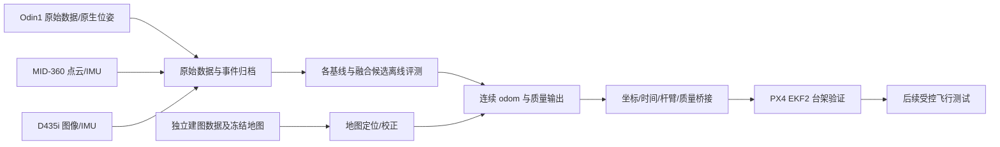

# 阶段一：20 平方米房间定位实验设计

协议版本：room-v0.1；日期：2026-11-16；状态：计划，尚未执行。

## 1. 要回答的问题

1. 当前各传感器是否能稳定、带正确时间戳地输出原始数据？
2. Odin1 与 MID-360＋FAST-LIO2 各自的误差、漂移、重复定位和延迟如何？
3. D435i 能否稳定跟踪现有自然结构，加入视觉后是否实际改善定位？
4. 固定地图能否提高重启后的房间坐标一致性，而不导致控制输出跳变？
5. 通过地面门槛后，PX4 是否正确接收并融合外部估计？

本阶段验证普通室内，不声称金属管道可用。20 m²是面积，不预设房间为 4×5 m。尺寸、飞行净空和路线都以现场测量为准。

## 2. 系统设计

此图是设计架构。归档工具、评测器、地图校正与 PX4 桥接目前尚未实现。原生闭源 Odin1 算法不能假设支持原始 bag 离线重跑；采集时必须保存它的实际位姿和状态输出。

地图校正可能不连续。保留 map→odom 和 odom→rig_base；桥接需要设计校正平滑/reset语义，并同步转换任务目标。不能将原始跳变直接传入控制。

## 3. 对照方案

| ID | 输入及算法 | 目的 | 当前可用性/边界 |
|---|---|---|---|
| B01 | Odin1，模式0，原生连续里程计 | 最快得到基线 | 文件和历史出数已确认，正式稳定性待测 |
| B02 | Odin1，独立建图后模式2 | 地图重复定位 | 配置支持；地图与运行实验待做，须确认已定位状态 |
| B03 | MID-360＋内置IMU，FAST-LIO2 | 可检查的激光惯性基线 | 配置和二进制存在，实际功能待核查 |
| B04 | D435i 左右灰度＋IMU，VIO候选 | 验证自然视觉信息价值 | 尚未实现；先选定一个VIO实现和标定 |
| B05 | MID-360＋IMU＋D435i单路图像，FAST-LIVO2 | 主融合候选 | 尚未实现；RGB/infra1作为不同变体，不混合结果 |
| B06 | B05＋固定地图校正 | 长期、重启一致性 | 后续开发项；FAST-LIVO2本身不等于完整固定地图定位 |

先完成 B01/B03 的可用性检查，再推进 B04/B05。B02 可在 Odin1 建图完成后并行安排实际试验。B06 不阻塞普通房间基线。

主对比为 B01↔B03、B03↔B05、B01↔B02。不能用 B02↔B03 的差异单独归因于硬件，因为地图先验不同。

B05 首选评估D435i全局快门灰度流的可行性；已调研的同硬件复现使用RGB，因此单路灰度适配必须单独验证。不能宣称左右双目已经进入FAST-LIVO2。

## 4. 场地、坐标和人工参考

- 测量房间尺寸，记录门窗、玻璃、家具、灯光、温度和自然纹理。不得为实验擅自布置AprilTag或动捕。
- 用已有墙角/门框等自然固定基准建立房间系：z向上，x/y方向及原点用文字/示意图固定。不要假定墙一定正交，记录测量误差。
- 同一刚性支架固定各传感器，定义可重复测量的 `rig_base`；记录照片、尺寸、安装版本与外参方向。
- 使用卷尺/激光测距和可重复放置的支架位置，测量至少6个停靠参考姿态，覆盖房间两轴和至少2个高度。无需增加视觉标记；可借助不进入视场的机械定位方式。
- 每个参考点包含三维坐标、轴向不确定度、参考点到rig_base的杆臂。测量不确定度建议≤0.01 m；无法达到则披露，不能用低精度参考验证更小误差。
- 位姿误差须比较同一参考点，不能直接比较相距数十厘米的两个传感器原点。
- 校准/对齐点与验收停靠点分开，禁止使用全部验收点求最佳变换后再宣称绝对位置准确。
- B01/B03每次启动若新建odom原点，可用独立测得的初始支架位姿建立该run的房间变换，并在动作开始前冻结；这是显式初始化，不是用测试轨迹做最佳拟合。B02/B06固定地图坐标的重启试验不得通过每run重新对齐消除重定位误差。
- 没有连续真值时，人工停靠只能验证离散位置；不推断停靠之间的全程误差。人工姿态不够准确时，旋转准确度记N/A。

## 5. 阶段、产物和门槛

| 阶段 | 工作 | 产物 | 进入下一阶段的依据 |
|---|---|---|---|
| S0 登记 | 场地、设备、固件、软件版本、安装及磁盘核查 | inventory/room/rig快照、批次计划 | 未知字段明确，无混用型号 |
| S1 数据 | 各传感器单独检查，再同步录60秒、10分钟 | 原始bag、频率/间隔/时间戳/资源报告 | 时间语义清楚，无时间回退；缺失被统计 |
| S2 标定 | 相机/IMU/外参/时差、参考坐标测量 | 有版本标定、原始标定数据与验证 | 留出数据验证；重新安装需新rig/calib ID |
| S3 地面基线 | B01/B03，随后B02/B04/B05 | 轨迹、停靠误差、事件、负载 | 基线可重复；确认图像实际参与B05更新 |
| S4 地图与验收 | 冻结地图与参数，独立批次每条件5次 | 原始记录、全部失败与汇总 | 精度可验证且达到约定目标；无真值项目保持N/A |
| S5 PX4台架 | 不解锁，检查输入、转换、融合、延迟和失效恢复 | bag＋ULog＋参数快照＋台架报告 | 固件对应配置正确、动态日志通过审查 |
| S6 后续飞行 | 用户明确安排后低速受控飞行 | ULog/传感器bag/定位及控制报告 | 不以地面静止结果代替飞行验收 |

本次不执行上述阶段，不修改飞控参数，不启动或停止现有传感器服务。

S1应核对每条流的实际帧率和时间间隔：间隔超过3个期望周期记录事件；期望周期从冻结模式得到，不给所有topic统一套10Hz。正式分析同时保留header时间与bag接收时间；两者相减只有在时钟域对齐且语义明确后才可解释。

## 6. 地面试验矩阵

先每条件3次筛查；参数冻结后，另采独立每条件5次验收。筛查用于发现问题，不并入正式统计。每次测试重新记录run ID、启动状态和初始化区间。

| ID | 路线/动作 | 建议时长或次数 | 主要指标 |
|---|---|---|---|
| T01 | 刚性静止，固定姿态 | 初始化结束后180 s | 去均值抖动、分段漂移、时间间隔 |
| T02 | 已测停靠点间直线往返 | 可用长度1–3 m；端点每次静止10 s | 稀疏停靠位置误差、位移误差 |
| T03 | 房间内矩形闭合路线 | 单圈30–60 s，尺寸实测 | 闭合误差、跳变、重复性 |
| T04 | 8字/多方向平移和yaw变化 | 60–90 s | 动态跟踪、失跟/恢复、处理延迟 |
| T05 | 相同位置不同朝向；同朝向不同高度 | 各停10 s，地面支架执行 | 姿态/高度变化是否造成定位偏差 |
| T06 | 回到独立参考位置，重新启动算法 | B01/B03相对各自启动原点；B02测固定地图坐标 | 重启后的坐标一致性、定位成功率/耗时 |

T03的闭合误差分别报告原始odom和地图校正后的结果；闭环优化压低端点误差，不代表中途误差小。T06中没有地图的里程计不要求恢复同一世界原点，其“全局重定位”指标为N/A。

手持/推车速度首轮建议0.2–0.5 m/s，roll/pitch采用平缓支架变化；实际速度和动作记录入表。飞行路线与速度另外制定，不直接沿用地面动作。

房间家具和灯光先固定。暗光/强高光/遮挡只在普通环境基线完成后形成单独扩展批次，单次只改变一个主要因素；金属管道试验另起协议。

## 7. 数据划分与公平比较

- `calibration`：估计内参/外参/时差；`mapping`：建立并检查地图；`tuning`：调参；`acceptance`：冻结后新采数据。
- 地图不能用验收数据更新后再用于同一验收的定位；记录地图生产算法、源run、hash、坐标系和裁剪/降采样。
- 每算法使用正确类型的地图，不假设Odin1 bin地图与MID-360 PCD可互换。
- 可以从同一条多传感器bag运行多个开源算法，作为配对比较；注明offline、回放倍速及实际运行资源。Odin1优先比较录到的原生位姿。
- 不能从只录topic名称判断传感器被用到；B05需记录视觉更新计数/残差或实现等价日志，并做图像启用/禁用消融。
- 同一原始bag可反复做开发分析，但每次analysis须新ID；反复调过的bag不得再称独立验收集。

## 8. 暂定验收目标

以下数值为room-v0.1研发目标，正式批次前冻结；当前均未实测。

| 指标 | 目标 | 适用条件 |
|---|---|---|
| 静止位置抖动P95 | ≤0.02 m | 相对该次静止均值，不代表绝对位置精度 |
| 静止分段漂移 | 首末10 s均值距离≤0.03 m/180 s | 同一坐标系，初始化后 |
| 固定参考停靠点三维RMSE/P95 | ≤0.05 / 0.10 m | 参考不确定度充分小，使用冻结对齐；不是连续ATE |
| 独立重启地图定位 | 5次中至少4次在30 s内成功 | B02/B06，成功还须参考误差达标；仅为初筛门槛 |
| 有效位姿覆盖率 | ≥99% | 初始化后完整区间；同时报告失效最长时长和reset |
| 桥接有效输出频率 | 按实际PX4版本要求，初始按30–50 Hz设计 | 真正的有效估计/IMU预测，不重复旧帧伪造频率 |
| PX4链路采样到发布延迟P95 | 目标≤0.10 s | 先验证时钟与stamp语义；不等于浏览器显示延迟 |

覆盖率定义：以冻结输出周期分箱，每箱至少有1条时间有效、状态有效且不陈旧的位姿计为覆盖。陈旧阈值按算法输出模式预登记；桥接阶段初始采用0.20 s报警阈值并结合实际PX4版本审查。原始观测龄期和IMU预测龄期分开统计。

对飞控候选，仅通过上述数值还不够：需动态台架验证坐标、杆臂、时间、速度、创新量、reset和中断恢复。任何未解决的错误方向、错误时间或静默失效均阻止进入飞行。

完整ATE/RPE、飞行悬停误差、最大动态误差，在有相应真值/飞行数据前不设“已通过”。地图定位4/5初筛成功率也不是部署可靠性保证。

## 9. 执行顺序及待办

- [ ] 测量房间与可重复停靠参考，确定参考不确定度。
- [ ] 登记设备真实型号、PX4版本与rig_base，冻结第一批计划。
- [ ] 实现只读核查/采集工具和显式topic清单，验证60 s数据完整性。
- [ ] 评估同步、标定及磁盘吞吐，完成10 min连续数据检查。
- [ ] B01/B03筛查，再用独立数据验收；记录全部失败。
- [ ] 建立B02地图与重启试验。
- [ ] 单独检查D435i视觉可观测性，再实现B04/B05及视觉消融。
- [ ] 设计并实现PX4桥接；台架验证后另行安排飞行。
- [ ] 普通房间结论稳定后，新建金属反射/暗光/重复几何协议。

## 10. 参考资料与适配边界

- [FAST-LIVO2官方](https://github.com/hku-mars/FAST-LIVO2)：融合候选，不宣称已有本地适配。
- [同类硬件ROS2复现](https://github.com/DeepRoboticsLab/fast-livo2-deep-robotics)：其RGB/MID-360s设置与当前ROS1、MID-360区别需核对。
- [PX4外部定位](https://docs.px4.io/main/en/ros/external_position_estimation)：接口、时序、参考坐标、延迟与EKF配置；执行时绑定实际固件文档版本。
- [RealSense D400数据手册](https://dev.realsenseai.com/download/42003/)：D435i各成像流、曝光/投射器和能力边界。

待现场确认：房间尺寸/参考方案、管道截面、补光方式、PX4固件/通信、设备当前状态。上述未知项不妨碍先完成地面实验准备。
